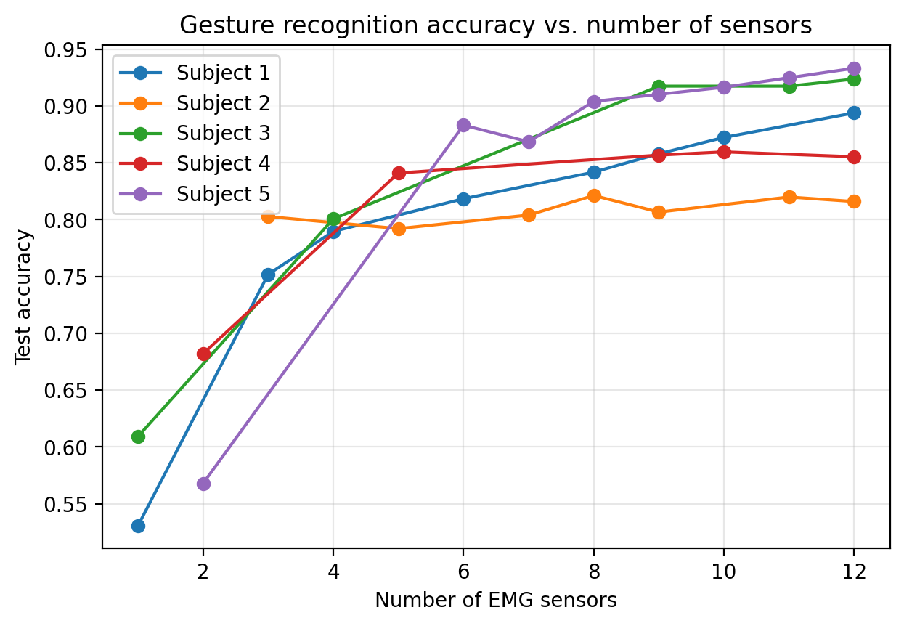

# How Many Muscle Sensors Do You Really Need?
### Sparse sensor selection for EMG gesture recognition

Wearable interfaces that read muscle signals (EMG) become cheaper, more comfortable,
and easier to put on with fewer electrodes. This mini-project asks: **how many of 12
forearm EMG sensors can be removed before gesture recognition breaks down, and do the
same sensors matter for everyone?**

## Setup
- **Data:** Ninapro DB2, subjects 1–5, Exercise B. Five classes: rest, finger
  abduction, fist, wrist flexion, wrist extension. 12 EMG electrodes at 2 kHz.
- **Features:** 200 ms windows (50 ms step); log mean absolute value and log RMS
  per electrode (24 features).
- **Split:** repetitions 1, 3, 4, 6 for training; 2 and 5 for testing (standard Ninapro protocol).
- **Method:** L1-regularized multinomial logistic regression, swept over penalty
  strengths. A sensor counts as "kept" if either of its features has a nonzero weight.
  For each sensor count, an unpenalized model is refit on the kept sensors to measure accuracy.

## Results

| Subject | All 12 sensors | Fewest sensors within ~5 points | Accuracy |
|---|---|---|---|
| 1 | 0.894 | 9 | 0.858 |
| 2 | 0.816 | 3 | 0.803 |
| 3 | 0.924 | 9 | 0.917 |
| 4 | 0.855 | 5 | 0.841 |
| 5 | 0.933 | 6 | 0.883 |

**1. Most sensors are redundant.** Accuracy rises steeply up to 4–6 sensors and then
plateaus. Subject 2 keeps nearly full accuracy with 3 sensors; Subject 4 with 5.

**2. The number needed varies widely between people** (3 to 9), which argues for
personalized sensor placement rather than one fixed layout.

**3. The best sensors differ by person but come from the same region.** No sensor
was selected for all five subjects in sets of 4 or fewer, but these small sets drew
almost entirely on sensors 8–12 (plus 2 and 4), while sensors 1, 3, 5, 6, and 7 were
never selected.

## Limitations
- Small scale: 5 subjects, 5 gestures, one linear model.
- The L1 path skips some sensor counts (e.g., Subject 3 jumps from 4 to 9 sensors).
- With ~500–750 test windows per subject, differences of 1–2 points are within noise.
- Models are trained and tested within each subject; cross-user performance is untested.

## Next steps
- Test whether a sensor set chosen on some users transfers to new users with little calibration.
- Use group-lasso or greedy elimination to evaluate every sensor count.
- Run the sparse model in real time on a low-cost EMG sensor.

## Reproducing
Open `emg_sensor_selection.ipynb` in Google Colab. The Ninapro data cannot be
redistributed; download subjects 1–5 of DB2 from https://ninapro.hevs.ch/instructions/DB2.html.

## Citation
Atzori, M., et al. (2014). Electromyography data for non-invasive naturally-controlled
robotic hand prostheses. *Scientific Data*, 1, 140053.
